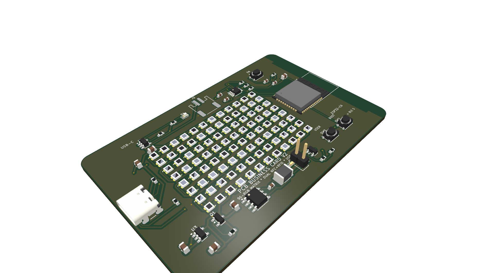
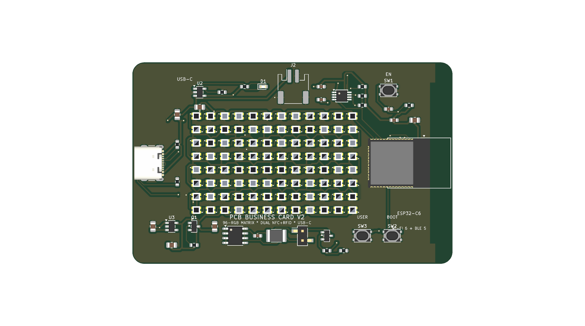
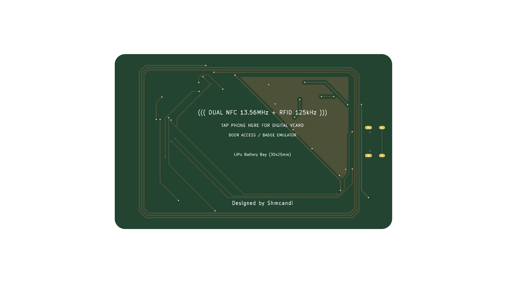

# ESP32-C6 Smart PCB Business Card V2 (96-RGB Matrix + Dual NFC/RFID)

An ultra-slim, monolithic smart electronic business card in the standard ISO/IEC 7810 ID-1 credit card form factor ($85.6 \times 54.0\text{ mm}$), powered by an **Espressif ESP32-C6-MINI-1** microcontroller.

Featuring an ultra-dense **96-LED addressable RGB micro-matrix (WS2812B-2020)** on the front, and a **Dual-Frequency 13.56 MHz NFC + 125 kHz RFID Contactless Engine** on the back with an integrated 4-turn planar spiral antenna etched directly in PCB copper.

Tap against any modern smartphone (iPhone / Android) to instantly deliver your digital portfolio and vCard, or tap against office turnstiles and RFID access readers to unlock doors — with onboard USB-C programming, autonomous Li-Po battery charging, and zero-drain hardware deep sleep.

Everything is engineered for 100% surface-mount assembly with **zero pin headers, zero through-holes, and zero sockets**.

---

## 📸 3D Renders

| Isometric Perspective View | Top View (96-LED Field) | Bottom View (Antenna & Battery Bay) |
| :---: | :---: | :---: |
|  |  |  |

---

## ⚡ Key Specifications & Features

- **Form Factor:** $85.6\text{ mm} \times 54.0\text{ mm} \times 1.6\text{ mm}$ (Standard ID-1 Credit Card Size with $3.18\text{ mm}$ corner radii). Fits standard wallets and card holders.
- **Microcontroller:** **ESP32-C6-MINI-1-N4**
  - High-performance 32-bit RISC-V core (up to 160 MHz) + ultra-low-power RISC-V coprocessor (up to 20 MHz)
  - 2.4 GHz Wi-Fi 6 (802.11ax), Bluetooth 5 (LE), Zigbee 3.0 & Thread (802.15.4 / Matter)
  - Onboard PCB trace antenna with dedicated RF copper clearance keepout
- **Display Matrix:** **96 Addressable RGB Micro-LEDs (WS2812B-2020)**
  - Arranged in a $12 \times 8$ grid ($4.0\text{ mm} \times 4.0\text{ mm}$ pitch) spanning $48.0\text{ mm} \times 32.0\text{ mm}$ across the front
  - Compact $2.0\text{ mm} \times 2.0\text{ mm}$ package with integrated constant-current driver ICs
  - Full 24-bit true color (16.7 million colors) per pixel, driven over a single high-speed GPIO line (`GPIO14`)
  - Serpentine daisy-chain layout with optimized collinear traces for maximum signal integrity
- **Dual-Frequency Contactless Subsystem (NFC + RFID):**
  1. **13.56 MHz High-Frequency NFC (ISO 14443A / NFC Forum Type 2):**
     - Powered by **NXP NTAG I2C Plus (`NT3H2111W0FHK`)** in a TSSOP-8 package
     - Connected to a **4-turn rectangular planar spiral loop antenna** etched directly into the bottom copper layer (`B_Cu`)
     - Resonates at $13.56\text{ MHz}$ with NTAG's $50\text{ pF}$ internal tuning capacitance
     - **Dual Interface:** Operates 100% passively without battery from the smartphone's RF field, and updates dynamically over I2C (`GPIO6` / `GPIO7`) from the ESP32-C6
     - **Field Detect Interrupt (`GPIO18`):** Wakes the ESP32 from deep sleep or triggers LED celebration animations when a smartphone is tapped
  2. **125 kHz Low-Frequency RFID (Building & Door Access):**
     - Powered by **Atmel/Microchip T5577 (`ATA5577C`)** transponder IC in SOIC-8
     - Emulates 125 kHz proximity cards (EM4100 / EM4200 40-bit IDs, HID ProxCard II, Indala) for office doors and turnstiles
     - Dual antenna interface: SMD 1812 transponder inductor (`L1`) + dedicated solder pads (`J3`) for thin wound enamel wire coils
     - **Active Modulation:** Features an onboard **BSS138 N-channel MOSFET (`Q2`)** driven by `GPIO1` (`RFID_MOD`) enabling active software-defined Manchester load modulation
- **Hardware Deep-Sleep Power Gate (Zero Standby Drain):**
  - Standard WS2812B LEDs consume $\sim 1\text{ mA}$ of static quiescent current per pixel even when turned black ($96\text{ LEDs} \approx 96\text{ mA}$ quiescent draw)
  - Incorporates an onboard **Diodes Inc DMG2305UX P-Channel MOSFET** load switch driven by `GPIO5` (`LED_EN`)
  - Physically disconnects the $V_{LED}$ power rail during ESP32 deep sleep, reducing standby current to microamps and enabling months of battery life
- **USB-C Interface:**
  - GCT USB4105 16-pin USB Type-C receptacle with $5.1\text{ k}\Omega$ CC pull-down resistors (compliant with USB-C PD / fast chargers)
  - Native USB-Serial/JTAG directly connected to ESP32-C6 `GPIO12` (D-) and `GPIO13` (D+) for instant flashing and serial logging without external UART bridges
- **Power & Li-Po Battery Charging:**
  - Autonomous Li-Po charger: Microchip **MCP73831T-2ACI/OT** ($300\text{ mA}$ charge rate) with red charging status LED (`CHG`)
  - High-efficiency LDO regulator: Diodes Inc **AP2112K-3.3** ($600\text{ mA}$ peak current, $55\,\mu\text{A}$ quiescent current, low dropout voltage)
  - Battery connector: SMD horizontal JST-PH 2-pin connector (`J2`) + dedicated rear $30 \times 25\text{ mm}$ silkscreen area for mounting an ultra-slim $3.7\text{V}$ Li-Po pouch cell (`302030` / `402030`, $150\text{–}250\text{ mAh}$)
- **Interactive Tactile Controls:**
  - `EN` (Reset) tactile switch (`SW1`) with RC debounce filter
  - `BOOT` (`GPIO9`) tactile switch (`SW2`) for firmware download / user interaction
  - `USER` (`GPIO4`) tactile switch (`SW3`) for mode cycling / games / menu navigation

---

## 📌 ESP32-C6 Pinout & Signal Mapping

| Signal | ESP32-C6 Pin | GPIO / Function | Electrical Type | Description |
| :--- | :---: | :---: | :---: | :--- |
| **LED_DIN** | Pin 19 | GPIO14 | Digital Output | Matrix Serial Data Input (800 kHz NZR stream) |
| **LED_EN** | Pin 10 | GPIO5 | Digital Output | LED Power Gate (Active-LOW: `LOW` = ON, `HIGH` = OFF) |
| **I2C_SDA** | Pin 12 | GPIO6 | I2C Open-Drain | NTAG I2C Plus Serial Data Line (4.7k pull-up to 3.3V) |
| **I2C_SCL** | Pin 13 | GPIO7 | I2C Open-Drain | NTAG I2C Plus Serial Clock Line (4.7k pull-up to 3.3V) |
| **NFC_FD** | Pin 24 | GPIO18 | Digital Input | NTAG Field Detect Interrupt (Active-LOW with 10k pull-up) |
| **RFID_MOD**| Pin 6 | GPIO1 | Digital Output | 125 kHz Active Load Modulation Gate via Q2 BSS138 |
| **USER_SW** | Pin 9 | GPIO4 | Digital Input | Tactile Pushbutton (Active-LOW with internal pull-up) |
| **BOOT_SW** | Pin 23 | GPIO9 | Digital Input | Boot Mode / User Button 2 (Active-LOW) |
| **RESET_SW**| Pin 8 | CHIP_EN | Reset / Enable | Active-LOW Hardware Reset with 10k pull-up + 100nF filter |
| **USB D-** | Pin 17 | GPIO12 | Differential D- | Native ESP32 USB-Serial/JTAG Data Minus |
| **USB D+** | Pin 18 | GPIO13 | Differential D+ | Native ESP32 USB-Serial/JTAG Data Plus |
| **CHG_STAT**| — | — | Open-Drain | MCP73831 Charge Indicator to Red LED `D1` |

---

## 🧮 Matrix Geometry & Serpentine Mapping

The 96 LEDs are placed in an alternating serpentine pattern to minimize trace length and eliminate cross-routing:

```
Row 0 (y=0):  LED  0  <--  LED  1  <-- ... <--  LED 11  (Right-to-Left, 0° rotation)
               |
Row 1 (y=1):  LED 12  -->  LED 13  --> ... -->  LED 23  (Left-to-Right, 180° rotation)
                                                 |
Row 2 (y=2):  LED 24  <--  LED 25  <-- ... <--  LED 35  (Right-to-Left, 0° rotation)
               |
Row 3 (y=3):  ... (repeats for 8 rows, ending at LED 95)
```

### Coordinate Conversion Function (FastLED / NeoPixel)

```cpp
// Map (x, y) coordinates where x is [0..11] and y is [0..7]
uint16_t XY(uint8_t x, uint8_t y) {
    if (x >= 12 || y >= 8) return 0;
    if (y & 0x01) {
        // Odd rows: Left to Right
        return (y * 12) + x;
    } else {
        // Even rows: Right to Left
        return (y * 12) + (11 - x);
    }
}
```

---

## 💻 Firmware

Complete production-grade firmware is available in the [`firmware/`](firmware/) directory, pre-configured for PlatformIO and the Arduino framework:

- **Source Code:** [`firmware/src/main.cpp`](firmware/src/main.cpp)
- **Bitmap Font (5x7):** [`firmware/include/font5x7.h`](firmware/include/font5x7.h)
- **Project Configuration:** [`firmware/platformio.ini`](firmware/platformio.ini)

### Supported Modes:
1. **Flowing Rainbow:** Smooth 2D diagonal rainbow gradients across all 96 LEDs.
2. **NFC Radar Wave:** Concentric radio wave pulsing animations representing NFC activity.
3. **Plasma Waves:** Dynamic sinusoidal color interference patterns.
4. **Starfield Sparkle:** Randomized twinkle/sparkle effects with soft exponential fade.
5. **Scrolling Text:** Smooth horizontal marquee text using the built-in 5x7 ASCII bitmap font.
6. **Phone Tap Celebration:** Automatic interrupt trigger when a smartphone taps the card (`GPIO18` Field Detect).
7. **Hardware Deep Sleep:** Long-pressing the `USER` button powers down the $V_{LED}$ power rail completely via the DMG2305UX P-MOSFET for zero standby battery draw, and registers wake-up on button press or phone tap.

---

## 📦 Hardware & Manufacturing Files

The board is 100% routed and verified with KiCad 10 DRC (0 unconnected items, 0 clearance errors), ready for turnkey assembly at JLCPCB / PCBWay:

- **KiCad PCB:** [`card_v2.kicad_pcb`](card_v2.kicad_pcb)
- **KiCad Project:** [`card_v2.kicad_pro`](card_v2.kicad_pro)
- **Order-Ready Gerbers Archive:** [`pcb_business_card_v2_gerbers.zip`](pcb_business_card_v2_gerbers.zip)
- **Bill of Materials (BOM):** [`fab_v2/BOM.csv`](fab_v2/BOM.csv)
- **Pick-and-Place Centroids (CPL):** [`fab_v2/CPL.csv`](fab_v2/CPL.csv)
- **Custom Footprints:** [`custom.pretty/`](custom.pretty/)

### Recommended Fabrication Settings:
| Parameter | Recommended Value |
| :--- | :--- |
| **Layers** | 2 Layers |
| **PCB Thickness** | 1.6 mm (standard) or 1.0 mm (ultra-slim wallet profile) |
| **Solder Mask** | Matte Black (best contrast for RGB LEDs) |
| **Silkscreen** | White |
| **Surface Finish** | ENIG (Electroless Nickel Immersion Gold) |
| **Copper Weight** | 1 oz Cu |

---

## 📜 License & Author

Designed and engineered by **Shmcandi**. Released under the **MIT License**.
